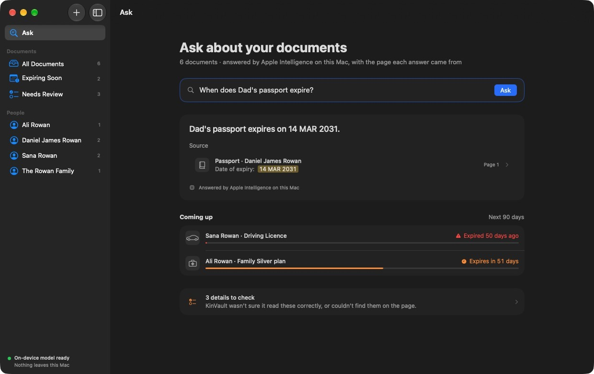
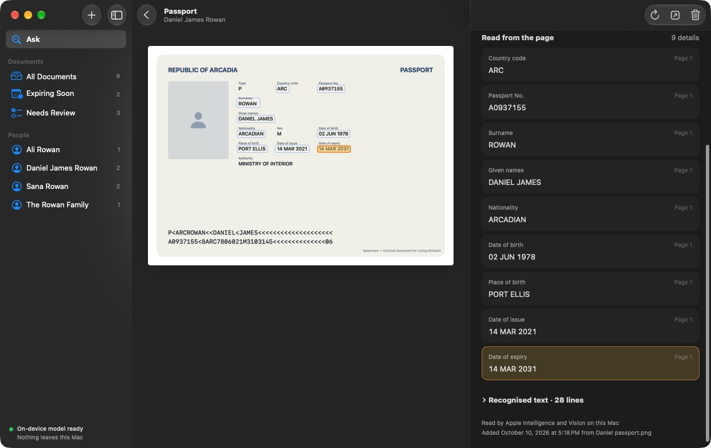
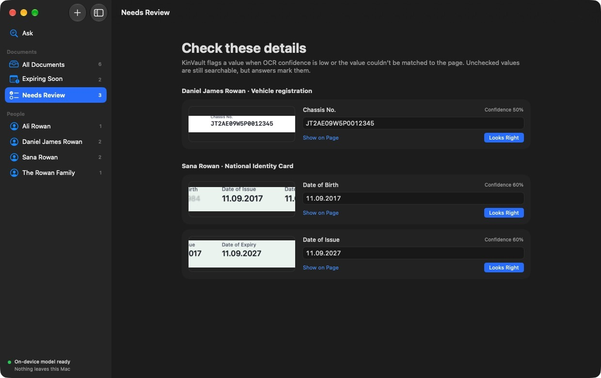
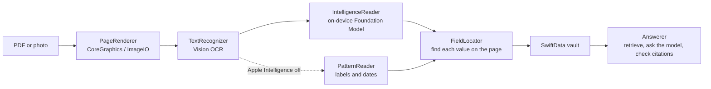

<div align="center">
  
  <h1>KinVault</h1>
  <p><strong>Ask your family’s documents a question. Get the answer and the page it came from.</strong></p>
  <p>
    A native Mac app that reads passports, ID cards, insurance cards and bills with Apple’s on-device OCR and
    Apple Intelligence. Nothing leaves your Mac — the app has no network access at all.
  </p>
  <p>
    <a href="https://m-nabeegh.github.io/kinvault/"><strong>Website</strong></a> ·
    <a href="#install">Install</a> ·
    <a href="#how-it-works">How it works</a> ·
    <a href="#privacy">Privacy</a>
  </p>
  
</div>

## What it does

Drop in a PDF, a scan or a phone photo of a document — onto the window, onto the Dock icon, or with **Open With › KinVault** in Finder. KinVault:

- **reads it** with Apple’s Vision framework, page by page — or straight from the text layer of a digital PDF, with exact positions;
- **understands it** with the on-device Apple Intelligence model — who it belongs to, what it is, the numbers and dates that matter;
- **pins every value to the page**, so any answer can show you exactly where it was read;
- **asks you to check** anything it isn’t sure about, with a crop of the page beside the value;
- **answers questions** like “When does Dad’s passport expire?” or “What is Sana’s licence number?”, citing the source field — or says **Not found in the vault** instead of guessing.

It also keeps an eye on expiry dates, groups documents by person (with nicknames like *Dad* or *Ammi*), notices when you add the same file twice, and can remind you before something lapses.

| Show on page | Needs review |
| --- | --- |
|  |  |
| Every answer opens the original page with the detail highlighted. | A value paired with the wrong label is caught, and the crop makes it obvious. |

## Install

**Requirements:** a Mac with Apple silicon, macOS 26 Tahoe or later, Xcode 26 or later.
Turn on Apple Intelligence (System Settings › Apple Intelligence & Siri) for the best results; without it, KinVault falls back to label-and-date patterns.

```bash
git clone https://github.com/M-Nabeegh/kinvault.git
cd kinvault
scripts/build-app.sh
open build/KinVault.app
```

`build-app.sh` compiles a release build with SwiftPM, wraps it in `build/KinVault.app`, and signs it ad hoc with the sandbox entitlements. Add `--zip` to also produce `build/KinVault.zip`. Move the app to `/Applications` if you want to keep it.

To try it without your own documents, choose **File › Add Sample Documents**. That imports six fictional documents for the Rowan family of the made-up Republic of Arcadia, drawn as images and read through the real pipeline.

You can also open `Package.swift` in Xcode and run the `KinVault` scheme. Runs from Xcode or `swift run` aren't sandboxed and can't post notifications, so use the script for the real thing.

## How it works



1. **Pages.** PDFs are rendered with CoreGraphics; photos (including HEIC) are loaded with ImageIO, respecting orientation. Up to 12 pages per document are read.
2. **Text.** Digital PDFs are read from their own text layer with PDFKit, split into lines and columns like OCR output. Scans and photos go through `RecognizeTextRequest`, which returns each line with its bounding box and confidence. A line where Vision garbles a figure (letters from the wrong script stuck to digits) is re-read from a tight crop, which fixes it. Lines are kept in reading order and stored with the document.
3. **Understanding.** The text is passed to `SystemLanguageModel` with a `@Generable` schema: kind, title, holder, issuer, issue and expiry dates, and up to 14 labelled fields. Sampling is greedy, so the same document always reads the same way.
4. **Grounding.** `FieldLocator` finds every value in the recognised text — exactly, ignoring spacing and punctuation, as the same calendar day written differently, allowing for classic OCR confusions (`O`/`0`, `I`/`1`), or across a line break. It then checks that the value sits beside its own label. Anything it can't ground, or grounds with low confidence, goes to **Needs Review**. Expiry and issue dates are only kept if they're printed on the page, and a date printed right beside an “expiry” label beats the model’s choice.
5. **Answering.** A question is matched against every fact with simple keyword scoring that understands nicknames and synonyms (*expire* ↔ *valid until*). The top facts go to the on-device model with short IDs; an answer is accepted only if it cites IDs that were actually provided. Otherwise the reply is *Not found in the vault*, with the closest matches.

### Project layout

```
Sources/
  KinVaultCore/          Platform logic, no UI. Fully unit-tested.
    Reading/             PageRenderer, TextRecognizer, DateReader, FieldLocator, PatternReader, ReadingPipeline
    Intelligence/        OnDeviceModel, IntelligenceReader
    Search/              Fact, Retrieval, Answerer, Expiry
  kinvault-cli/          Command-line front end to KinVaultCore (JSON output)
  KinVault/              The SwiftUI app
    Support/             SwiftData models, Library (import queue), files, lock, reminders, export
    Views/               Ask, documents table, document detail, review, settings
    Samples/             The fictional specimen documents
Tests/
  KinVaultCoreTests/     Unit tests, end-to-end reading of generated images and PDFs, on-device model tests
  KinVaultAppTests/      The app's vault: import, duplicates, review, nicknames, delete, erase, export
Packaging/               Info.plist, entitlements, app icon
scripts/                 build-app.sh, make-icon.swift
docs/                    The GitHub Pages site
```

### Command line

The same engine is available from Terminal, which is handy for scripting and for checking how a document reads:

```bash
swift build -c release --product kinvault-cli
.build/release/kinvault-cli status
.build/release/kinvault-cli read "~/Documents/Passport scan.pdf"
.build/release/kinvault-cli ask "When does Dad's passport expire?" passport.pdf car.png --alias "Daniel James Rowan=Dad"
```

Output is JSON: every field with its page, box and confidence, and every answer with its citations. `--no-ai` uses the pattern reader. Exit codes are `0` success, `1` bad usage, `2` a file couldn’t be read, `3` the answer wasn’t found.

### Tests

```bash
swift test
```

Seventy-odd tests in two targets. The core suites cover date reading and day-first/month-first inference, value grounding and the wrong-label check, the PDF text layer, garbled-line detection, retrieval with nicknames, citation validation and expiry wording, and read real generated files end to end — a photo, a digital PDF, a scanned PDF and a two-page PDF. The app suites import the six sample documents into an in-memory vault and exercise duplicates, corrections, review, nicknames, delete, erase and export. Tests that need Apple Intelligence run only when it’s available.

## Privacy

These are properties of the build, not promises:

- **No network.** The app is sandboxed with only `com.apple.security.app-sandbox` and `com.apple.security.files.user-selected.read-write` ([entitlements](Packaging/KinVault.entitlements)). Without `network.client`, macOS blocks every connection. Check any build with `codesign -d --entitlements - build/KinVault.app`.
- **On-device model only.** KinVault uses `SystemLanguageModel`. It never touches `PrivateCloudComputeLanguageModel` or any server.
- **No account, no sync.** The SwiftData store is created with CloudKit off. Documents are copied into the app’s container under `~/Library/Containers/io.github.m-nabeegh.kinvault/`.
- **Out of Spotlight.** The vault folder carries `.metadata_never_index`.
- **Optional extras stay local.** Touch ID lock uses LocalAuthentication; expiry reminders are scheduled by macOS with UserNotifications.
- **Your data is portable.** Settings › Privacy exports the original files plus a readable `vault.json`, and can erase everything.

## Known limits

- Apple Intelligence’s on-device model has a small context window, so roughly the first 7,000 characters of a document are used for extraction. Long contracts are filed and searchable by their key fields, not read cover to cover.
- On some macOS 27.0 builds, Vision’s *accurate* recogniser can hang inside the Neural Engine compiler service. KinVault waits 45 seconds (the first request after a restart legitimately takes 10–15 while the model compiles), then switches to *fast* recognition for the session and notes it on each document. Restarting the Mac clears it.
- Numeric dates like `03/04/2030` are read day-first or month-first from other dates on the same document, then from your Mac’s region.

## Licence

MIT — see [LICENSE](LICENSE). The sample documents are fictional and generated by the app.
